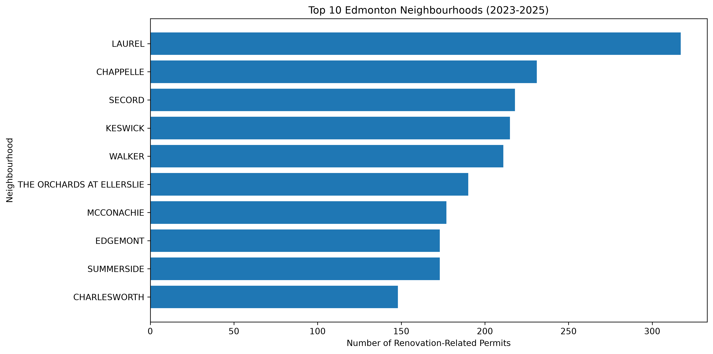
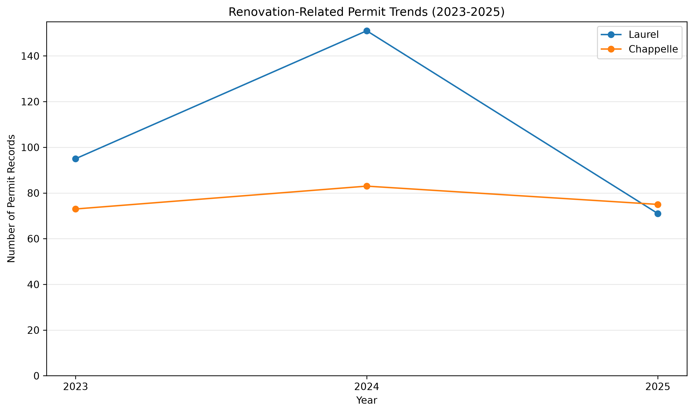

# Edmonton Renovation Market Analysis

Exploratory business analytics project using the City of Edmonton's General Building Permits dataset to understand where **possible home-renovation permit activity** is concentrated and how it changes over time.

**Status:** Exploratory analysis in progress. The results are descriptive, not a forecast of 2027 demand or profitability.

## Business question

Which Edmonton neighbourhoods merit further investigation for a hypothetical residential renovation company's 2027 market research?

We examine:
1. The distribution of possible renovation-related permits across neighbourhoods.
2. Yearly changes in permit counts, especially from 2023 through 2025.
3. Interior and exterior alteration keywords and overlaps.

## Dataset

- **Source:** City of Edmonton Open Data Portal
- **Dataset:** General Building Permits
- **Dataset ID:** `24uj-dj8v`
- **Official dataset:** https://data.edmonton.ca/d/24uj-dj8v
- **Local download:** November 21, 2026
- **Downloaded snapshot:** 249,178 rows and 25 columns
- **Fields used:** `JOB_CATEGORY`, `JOB_DESCRIPTION`, `YEAR`, `NEIGHBOURHOOD`

The raw CSV is excluded from this repository. The script expects the downloaded snapshot at `data/raw/General_Building_Permits_20261121.csv`. If using a newer download, update `file_path` in the script and expect results to differ.

## Tools

- Python (developed using Python 3.14)
- Pandas for data loading, text filtering, grouping and comparisons
- Git for version control

See `requirements.txt` for the environment's recorded Python package versions.

## Method

1. Load the permit CSV into a Pandas DataFrame.
2. Select records where `JOB_CATEGORY` is `Home Improvement`.
3. Flag potential renovations using case-insensitive matches for `renovat`, `alterat`, or `remodel` in `JOB_DESCRIPTION`.
4. Examine `interior alterat` and `exterior alterat` descriptions. Account for records matching both phrases to avoid double-counting.
5. Count potential renovation permits by `NEIGHBOURHOOD` and `YEAR`.
6. Compare Laurel and Chappelle's yearly counts and percentage changes for 2023–2025.

This is a **keyword-based proxy**, not a manually validated classification of renovation projects.

## Preliminary results

### Permit counts

| Metric | Count |
| --- | ---: |
| All building permits in downloaded snapshot | 249,178 |
| Home Improvement permits | 63,934 |
| Possible renovation-related permits | 20,396 |
| Possible renovation-related permits, 2023–2025 | 7,455 |
| Possible interior alterations | 16,930 |
| Possible exterior alterations | 4,127 |
| Matching both interior and exterior alteration phrases | 693 |

The possible-renovation matches represent **31.9%** of the Home Improvement records in this snapshot.

### Top neighbourhoods, 2023–2025

| Neighbourhood | Possible renovation permits |
| --- | ---: |
| Laurel | 317 |
| Chappelle | 231 |
| Secord | 218 |
| Keswick | 215 |
| Walker | 211 |
| The Orchards at Ellerslie | 190 |
| McConachie | 177 |
| Summerside | 173 |
| Edgemont | 173 |
| Charlesworth | 148 |

### Laurel and Chappelle by year

| Neighbourhood | 2023 | 2024 | 2025 | Total |
| --- | ---: | ---: | ---: | ---: |
| Laurel | 95 | 151 | 71 | 317 |
| Chappelle | 73 | 83 | 75 | 231 |

Laurel has a larger three-year count, whereas Chappelle's annual counts fluctuate less across these three years. Neither observation establishes future customer demand.

## Run locally

From the project root on Windows (Command Prompt):

```cmd
python -m venv .venv
.venv\Scripts\activate
python -m pip install -r requirements.txt
```

Download the official General Building Permits CSV and save it to:

```text
data/raw/General_Building_Permits_20261121.csv
```

Then run:

```cmd
python src\explore_permits.py
```

The program prints exploratory counts and neighbourhood comparisons in the terminal. It does not yet create a dashboard.

## Limitations

- Permit records are **not** verified renovation projects, individual customers, revenue, or profit.
- Keyword matching may miss relevant work or include unrelated work.
- A permit description may refer to several kinds of construction activity.
- Counts are not normalized by housing stock, neighbourhood population, or building age.
- Permit activity can be affected by reporting practices and the coverage of the downloaded data.
- The 2026 calendar year is incomplete in the November 21, 2026 snapshot; comparisons focus on 2023–2025.
- Correlations in permit counts do not establish causality or predict future work.

## Next steps

- Review a sample of matched and unmatched descriptions to assess classification quality.
- Investigate missing or inconsistent neighbourhood and date values.
- Compare neighbourhoods using relevant denominators and additional indicators.
- Explore construction value measures carefully, accounting for missing values and outliers.
- Build visualizations and an Excel dashboard after validating the methodology.
- Summarize conclusions and limitations in an evidence-based business report.

## Data Visualization

The chart below shows the 10 Edmonton neighbourhoods with the highest number of renovation-related permit records between 2023 and 2025.



### Laurel vs. Chappelle: Yearly Trends (2023–2025)

The following chart compares annual renovation-related permit records in Laurel and Chappelle.



Note: These figures represent permit records identified using renovation-related keywords, not confirmed renovation projects or business revenue.

## Business Insights: Laurel vs. Chappelle (2023–2025)

### Key Findings

The analysis compares renovation-related building permit records in two Edmonton neighbourhoods: Laurel and Chappelle.

**Laurel**
- 2023: 95 permit records
- 2024: 151 permit records (+58.9%)
- 2025: 71 permit records (-53.0%)

Laurel experienced substantial fluctuations during the selected period. Permit records increased sharply in 2024 before declining in 2025.

**Chappelle**
- 2023: 73 permit records
- 2024: 83 permit records (+13.7%)
- 2025: 75 permit records (-9.6%)

Chappelle showed smaller year-over-year changes, suggesting relatively stable permit activity during this three-year period.

### Business Implications

Laurel recorded more renovation-related permits overall, but its annual activity fluctuated considerably.

Chappelle showed more consistent permit counts, which may warrant further investigation by businesses seeking areas with steadier activity.

These findings can help identify neighbourhoods for additional market research, but they are not sufficient to determine business profitability or future renovation demand.

### Limitations

The analysis uses permit descriptions containing renovation-related keywords. These records are not verified renovation projects and do not directly measure customer demand, project value, business revenue, or profitability.

The comparison also covers only three years. Further research is needed before making investment or business expansion decisions.


## Author

**Meral Guler**

Business Analytics student, University of Alberta

Independent educational portfolio project. Not affiliated with the City of Edmonton.
